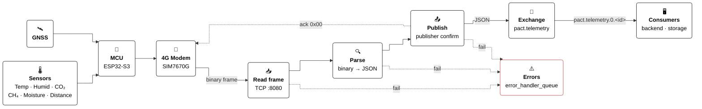
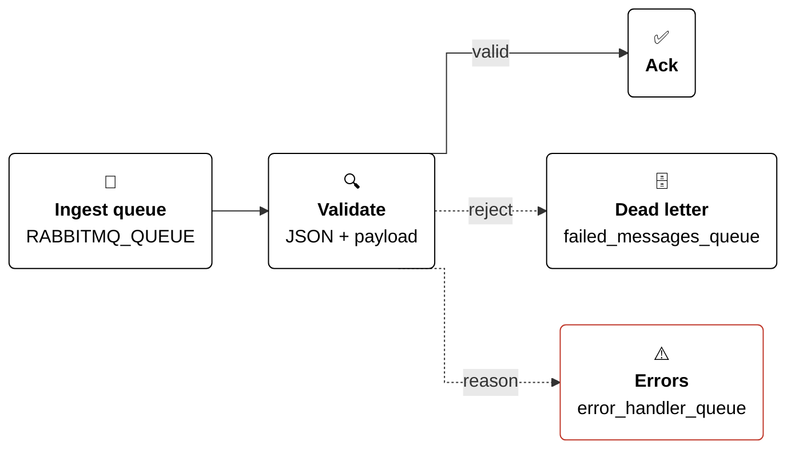

# Ingest Service — Data Flow

How one telemetry upload travels from the field unit, through the ingest service, into RabbitMQ.

## Overview

Solid arrows show telemetry moving forward. Dotted arrows show the acknowledgement sent back to the device and the error paths.

## Step by step

| # | Stage | Where | What happens |
|---|-------|-------|--------------|
| 1 | **Collect** | MCU | Sensors are read and averaged each minute, then buffered in flash. |
| 2 | **Upload** | 4G modem | Every 15–30 min the MCU opens a TCP connection to port `8080` and sends one binary frame holding all buffered readings. |
| 3 | **Read frame** | `telemetry.ReadMessage` | Reads the 14-byte header, works out the body length from the record count and GPS/cell flags, then reads exactly that many bytes. Read timeout is 1 min. |
| 4 | **Parse** | `telemetry.Parse` | Checks the magic bytes and version, then decodes each reading into structured telemetry. |
| 5 | **Publish** | `rabbit.PublishTelemetry` | Publishes persistent JSON to topic exchange `pact.telemetry` with routing key `pact.telemetry.<version-major>.<device-id>`, then waits for the RabbitMQ publisher confirm. |
| 6 | **Acknowledge** | `server.handleConnection` | Sends the single byte `0x00` back to the device and closes the connection. The device can now clear its buffer. |
| 7 | **Consume** | Downstream services | Bind queues to `pact.telemetry` and filter with routing keys, for example `pact.telemetry.0.#` for every v0 device. |

If any of steps 3–5 fails, no ack is sent. The error and the raw payload are published to `error_handler_queue`, and the device keeps its buffer to retry on the next upload.

## Queue consumer path

The service also consumes `RABBITMQ_QUEUE` and validates what arrives there.

Malformed messages are rejected with `requeue=false`, so RabbitMQ dead-letters them to `failed_messages_queue` when the queue has DLX arguments. The reason for the rejection goes to `error_handler_queue`.

## Related docs

- [telemetry.md](telemetry.md) — binary frame layout
- [rabbitmq.md](rabbitmq.md) — exchange, routing keys and JSON schemas
- [ARCHITECTURE.md](ARCHITECTURE.md) — full system architecture
